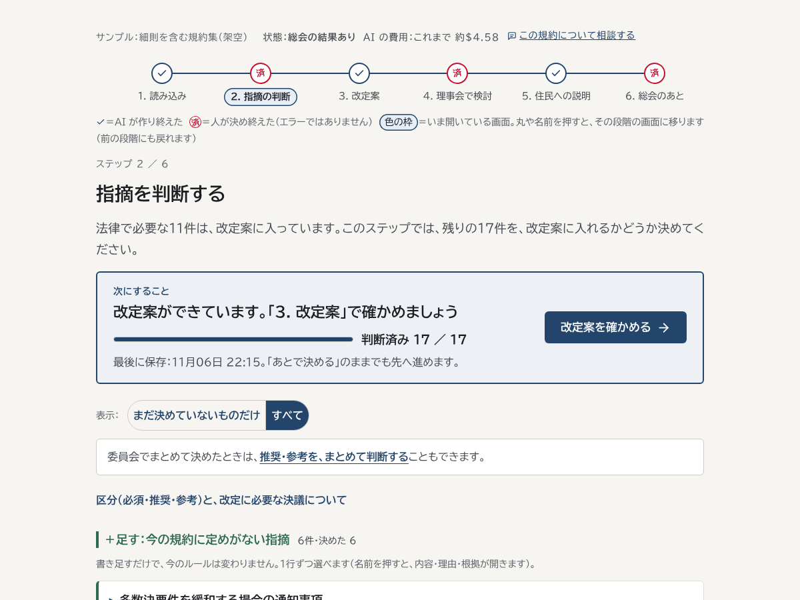
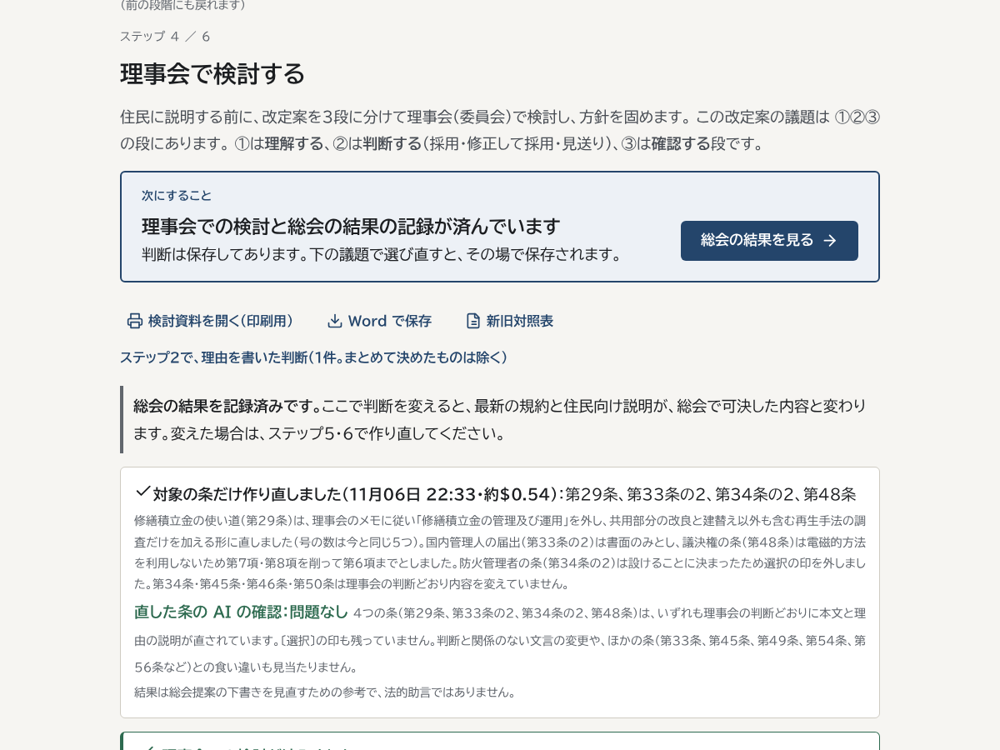
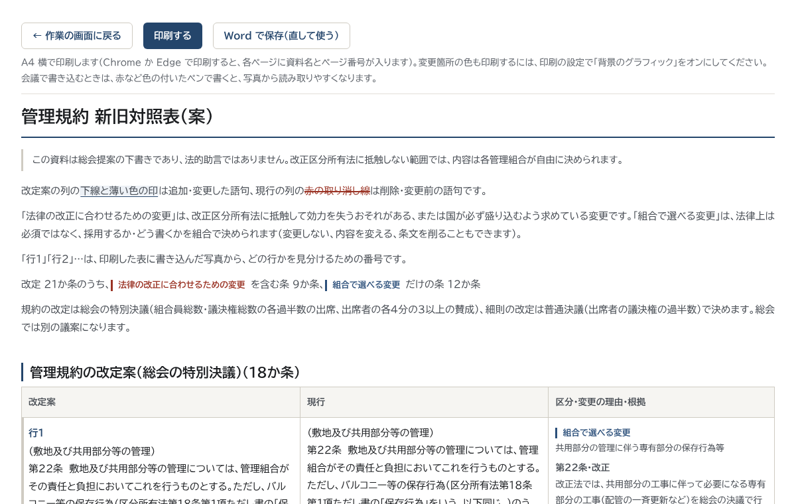
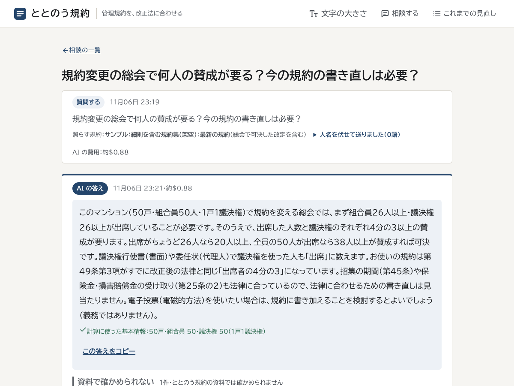
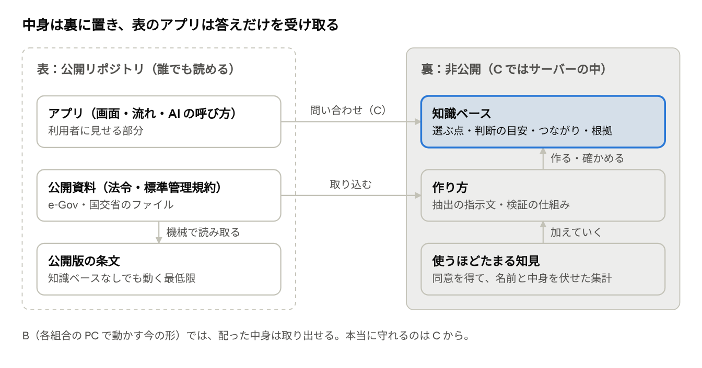

# ととのう規約（kiyaku-kaisei）
管理規約を、改正法に合わせる。

2026年4月施行の改正区分所有法に、マンションの管理組合が専門家に頼らず、自分たちで管理規約を合わせるための AI ツールです。Built with Claude: Japan 2026 の提出作品（β版）です。

**出力は「総会提案の下書き」であり、法的助言ではありません。**

- **デモ動画（3分）**：https://youtu.be/04kzeyyCAbM
- **審査員の方へ**：ログインして実際に操作できる期限付きの公開版を用意しました（URL とログイン情報は提出フォームに記載）
- **成果物の見本**（架空のサンプルで作ったもの。ログイン不要）：[新旧対照表](docs/samples/01_taisho.pdf)・[理事会の検討資料](docs/samples/02_board.pdf)・[住民向けの説明](docs/samples/03_explain.pdf)・[宿題の検討表](docs/samples/04_shukudai.pdf)（PDF）、[最新の規約](docs/samples/05_kiyaku_latest.docx)（Word）

## 3分でわかる、ととのう規約

**誰の、どんな困りごとか**
- 改正法に合わない規約の定めは、施行後に効力を失うおそれがあります。全国の管理組合が、規約の見直しを迫られています
- ところが、見直しを担うのは専門家ではない理事・委員です。条文を読み解き、改定案と総会の資料を作るのは大きな負担で、専門家に頼めない組合も多くあります

**何ができるか**：規約を読み込んでから、総会のあとの最新の規約まで、6つのステップで進めます。どのステップも、上の「次にすること」の枠に従えば先へ進めます。

| ステップ | 人がすること | AI・プログラムがすること |
| --- | --- | --- |
| 1. 読み込み | 今の規約（Word・PDF・テキスト。細則を含む規約集も可）を読み込む | 改正法と国の標準管理規約に照らして、直す箇所を根拠の条文付きで洗い出す（必須・推奨・参考） |
| 2. 指摘の判断 | 推奨・参考の指摘を、改定案に入れるか決める | 今の規約に定めがない「足す」と、定めがある「変える」に分けて見せる |
| 3. 改定案 | 新旧対照表で確かめ、必要なら条の文を直す | 改定案と新旧対照表を作り、別の AI（確認役）が採点して合格まで直す。人が直した文も、法律に合うかを根拠付きで確かめる |
| 4. 理事会で検討 | 議題ごとに判断し、組合が選ぶ点（〔選択〕・今の規約の両案）を選ぶ | 改定案を3段（理解する・判断する・確認する）に分けた検討資料を作る。判断に合わせて、対象の条だけを作り直す |
| 5. 住民への説明 | 説明資料を読み、配る前に直す | 住民が読める言葉で、変更の理由と暮らしへの影響を書く |
| 6. 総会のあと | 議案ごとの結果を記録する | 可決した改定を反映した最新の規約・細則を組み立てる（AI は使わない） |

- 資料は A4 で印刷でき、Word でも保存できます。会議で印刷物に赤ペンで書き込んだら、写真で戻すと AI が読み取って反映の提案にします
- **これからの見直し**：作業の画面は「今回の改正」（上の6ステップ。法改正に合わせる一部改正）と「これからの見直し」の2つに分かれます。これからの見直しでは、今の規約と標準管理規約の条の対応表と規約集の構成表を見ながら、理事会が条ごとに「今のまま・合わせる・見直す・なくす・足す」を記録し、見直す条は、両方の文を左右に並べた「宿題の検討表」として印刷できます（AI は使わない）。全部改正や、少しずつの改正の準備に使います
- **相談する**：「規約変更の総会で何人の賛成が要る？」のような質問や、住民向けのニュース原稿・議事録の確認に、条文を読んだうえで根拠付きで答えます。定足数・賛成数はプログラムが計算し、人名は伏せて AI に送ります
- 作者自身がマンションの規約見直し委員として、実物の規約で使いながら作りました（実物の規約はこのリポジトリに入れていません）

**理事会で検討する**：改定案を3段に分けた検討資料と、議題ごとの判断（採用・修正して採用・見送りなどのボタン）。判断に合わせて、対象の条だけを作り直す

**新旧対照表**：改定する条を、今の規約と並べて見比べる。印刷して会議で使える

**相談する**：質問に、条文を読んだうえで根拠付きで答える。賛成の数などはプログラムが計算する

画面はすべて架空のサンプルです。

## Claude の使い方

| どこで | 使ったもの | 工夫 |
| --- | --- | --- |
| 点検・改定案づくり | **Managed Agents**＋**Agent Skills**＋カスタムツール | 改正の知識をスキルにして持たせ、規約・標準管理規約・区分所有法の条文は道具で一条ずつ渡す。改定案は **Outcomes** の採点役（11項目のルーブリック）が合格まで差し戻す。止まっても続きから再開できる |
| 説明文・写真の書き込み・直した文の確認・対象の条だけの作り直し | **Claude API**（Messages API） | 構造化出力で決まった形で受け取る。断られたときは自動で別のモデルにやり直す（フォールバック） |
| 相談する | **Claude API**（道具の呼び出し） | AI が読んだ条だけを根拠として受け付け、読まずに書いた根拠は差し戻す。根拠のない断定は「資料で確かめられない」に下げる |
| 開発 | **Claude Code**（claude.ai/code とスマホの Claude アプリ）、**Claude.ai の Artifacts** | 作者は外出中もスマホで開発を進めた。人に確かめてほしい点を「確認ボード」（Artifact）に載せ、結果を読んで直し、自動テストに変えた |

**根拠を守る仕組み**：指摘には必ず区分所有法か標準管理規約の条を付け、存在しない条や、引用が規約の本文と一字一句合わないものは受け付けません（「根拠を示せない指摘は出さない」）。

## どう確かめたか

- **評価**：国の標準管理規約から作った架空の評価用規約3本で、正解（国交省の改正箇所の見え消し）と比べた。3本とも、法律で必ず直す論点 8/8 を正しい条で検出し、誤った指摘は0件。根拠の正しさは 100%（標準管理規約での評価。`evals/`）
- **想定ユーザーでの確認**：架空の想定ユーザー3人（スマホの72歳の理事長・Mac の委員・スマホの新任理事）が、本物の AI で点検から最新の規約まで画面のボタンだけで通し、見つかった問題を直した。2回行った（11/6 合計 約$13、11/8 合計 約$14。2回目は確認ボード第28回 `docs/checks/r28.md`）
- **画面の総点検**：19の状態（作る前・作っている途中・止まった・総会のあと など）×6ステップ×パソコンとスマホの194画面を撮り、機械と目で点検（問題0件）
- **自動テスト**：265件（`uv run pytest`。API を呼ばない）
- **成果物の見本**：冒頭のリンク（架空の「長く改正していない古い規約」で、点検から総会のあとまで済ませた作業から書き出したもの。`docs/samples/`）

## 作り方（開発のプロセス）

作者（マンションの規約見直し委員会の委員）と Claude で、11/2〜11/8 の7日間で作りました（コミット約240件）。

1. **決める**：作者が課題と使う人を決め、Claude が仕様と改正の論点を一次資料（法令・国交省の資料）で確かめて整理する。大きな変更は、Claude が計画を示し、作者が承認してから作る
2. **作る**：Claude Code で実装し、区切りごとにコミットする。作者は外出中や寝る前も、スマホの Claude アプリから指示を出した
3. **使う**：作者が実物の規約（非公開）で使い、気づきを伝える
4. **AI が先に確かめる**：自動テスト、画面の総点検、架空の想定ユーザーが本物の AI で最後まで通す確認、評価用の規約での評価
5. **人は大事な点だけ確かめる**：AI が確かめたことと、人でないと分からないことを分け、「確認ボード」（claude.ai の Artifact）に回ごとに載せる（28回）。作者の結果やメモを Claude が読んで直し、自動テストに変える
6. **記録する**：日ごとの記録（`progress.md`）と、回ごとの確認の記録（`docs/checks/`）を残す

**いちばん苦労したこと**：作者自身が規約見直し委員の当事者だったことです。実物の規約集で試すたびに「これも要る」が見つかり、機能を足すうちに、法改正への対応の流れが長く複雑になりました。そこで当初の目的に立ち返り、作業の画面を「今回の改正」（法改正に合わせる一部改正の一本道）と「これからの見直し」（全部改正などの準備。急がない）の2つの場所に分け、一部改正でツールがすることも、改正・新設・削除だけに絞りました。動く試作で確かめてから組み込み、想定ユーザーで通して迷う所を直しました。

## β版と正規版（ととのう規約 データベース）

今回の提出はβ版です。正規版では、法令と国の標準管理規約（解説を含む）を条ごとに整理し、原文で裏付けた独自の知識ベース「ととのう規約 データベース」を裏側で使い、各マンションが自分で決めることを根拠付きで示します。

- **表（このリポジトリ）**：アプリと、公開資料（法令・標準管理規約）と、それを機械で読み取った条文。知識ベースがなくても、β版として全部の機能が動く
- **裏（非公開）**：知識ベース（組合が選ぶ点・判断の目安・法と規約のつながり・根拠）と、その作り方（抽出と検証の仕組み）。AI が書いたものは、原文の引用が一字一句合うものだけを残す
- アプリは知識ベースに問い合わせて、答えだけを受け取る（入口は `core/kb.py`。知識ベースがなければ何も変えない）
- **試作で確かめた効果**：標準管理規約が断定せず各マンションに任せている点（役員の任期、理事会の招集の決まり、暴力団員への貸与の禁止）について、同じ質問を相談の AI に聞いた。β版は「国の解説を確かめられない」と答えたが、知識ベースを使うと、国の解説を根拠に具体的な目安と選択肢を示した。1回の費用はほぼ同じ（約$0.12〜0.16）

## 今後の計画

| 段階 | 内容 |
| --- | --- |
| 今回（β版） | 作者の管理組合や知り合いの管理組合で試す段階。単棟型の標準管理規約に対応 |
| 次（正規版の土台） | ととのう規約 データベースを整え、法的な中身を人の確認に通す。作者の管理組合で、委員会・理事会・総会まで通して使う |
| 正規版（2027年春までに） | 標準管理規約が各マンションに任せている点（両案・空欄・解説の選択肢）を、知識ベースを使ってすべて扱う。これからの見直しで決めた見直しを、今回の改定案づくりに渡す。標準管理規約をベースにした全部改正の下書きと、細則の整理の案を出す |
| その後 | API キーを用意しなくても使えるサービスとして提供する。団地型・複合用途型、関連する法令に広げ、法改正や標準管理規約の改正に追いつく |

詳しくは `docs/plans/今後の展開.md`。

## リポジトリの案内

| 場所 | 内容 |
| --- | --- |
| `app/` | 画面（FastAPI・Jinja2） |
| `core/` | 規約の読み取り、AI の呼び出し、最新の規約の組み立て など |
| `agents/`・`skills/` | Managed Agents の設定と、改正の知識のスキル |
| `evals/` | 評価用のデータと評価の仕組み |
| `tests/` | 自動テスト |
| `docs/` | 設計・改正の論点・確認の記録・計画など。案内は [docs/README.md](docs/README.md) |
| `data/public/` | 公開資料（区分所有法・標準管理規約）と、それを機械で読み取った条文（出典は `data/public/SOURCES.md`） |

- 技術構成：FastAPI＋Jinja2（画面）、Claude Managed Agents と Claude API（AI の部分）、Python 3.13・uv。詳しくは [docs/ARCHITECTURE.md](docs/ARCHITECTURE.md)
- 技術的な確認のために手元で動かす手順：[docs/SETUP.md](docs/SETUP.md)（開発者向け）
- 公開しているデータは、公開資料と架空のサンプルだけです。作者が試した実物の規約や、読み込んだ規約・判断の記録は、このリポジトリに入れていません

## English summary

**Totonou Kiyaku** helps condominium owners' associations in Japan bring their bylaws in line with the amended Act on Building Unit Ownership (in force April 2026), without hiring experts. Upload the current bylaws; Claude checks them against the law and the government's model bylaws and lists what must or should change, each with the article it rests on. The committee decides, and the tool drafts the amendments, a side-by-side comparison, a board review paper, a plain-language explanation for residents, and finally the updated bylaws after the general meeting. A Q&A mode answers questions with cited articles and computes quorum and vote counts. Built with Managed Agents (with Agent Skills, custom tools and Outcomes grading) and the Claude API. This submission is the beta; the full version will draw on a private, curated knowledge base of the law and the model bylaws. Output is a draft for the general meeting, not legal advice.
